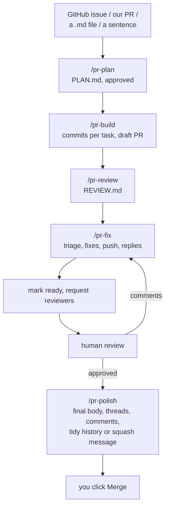

# PR Workflow

How one piece of work goes from an issue to a merged PR using the five
`pr-*` skills. This is the user-facing guide: what to run, in what
order, what each step produces, and where the gates are. The skills
themselves are the reference (`/pr-<name> --help`, or
`skills/pr-<name>/SKILL.md`).

## The shape

One unit of work is one branch that becomes one PR, usually against one
GitHub issue. Every step reads and appends to the same directory,
`~/Reports/<org>/<repo>/prs/<branch-slug>/`, so nothing lives only in a
conversation.

This is the single-PR track. A feature that decomposes into many
sub-issues on one branch uses `/feature-create` → `/feature-plan` →
`/feature-work` instead.



Two review loops share `/pr-fix`. The first is ours, before anyone
else sees the PR: `/pr-review` produces a REVIEW.md and `/pr-fix`
triages it. The second is the human one: reviewers leave threads on
GitHub and `/pr-fix` triages those. Same skill, different source.

## The order, and what each step does

### 1. `/pr-plan <source>`

Turns a source into an approved plan before any code exists.

- **Source:** a GitHub issue (`<org>/<repo>#N`, URL, or `#N`), one of
  our own PR URLs (to backfill a plan onto in-flight work), a path to a
  markdown file (an audit report, a design doc export), or a sentence.
- **What it does:** fetches the source, reads the code the change
  touches and the dependencies the approach leans on, sizes the work
  (`lib/pr-discipline.md` § Sizing), writes `PLAN.md`. Sizes M and up
  get one `adversarial-reviewer` pass on the plan, ruled on by an
  `adjudicator`, before you see it. XS and S skip it.
- **Gate:** the plan is shown inline. You answer approve, discuss, or
  don't build. Discussion edits the plan in place and re-shows it.
- **Produces:** `PLAN.md` with status `approved` (or `no-build`), plus
  `source.md`, `orient.md`, and `plan-attack.md` when the attack ran.
- **Never:** writes to GitHub, creates a branch, touches code.

The plan is the contract everything downstream is measured against.
Its Scope In and Scope Out are what `/pr-review` grades against and
what `/pr-fix` triages against. Its Tasks become the commits.

### 2. `/pr-build`

Executes the approved plan on an Opus session.

- **What it does:** finds or creates the branch worktree from a
  freshly fetched upstream base, walks the plan's Tasks in order with
  one commit and a targeted test run per task, runs the full suite,
  checks the branch against the plan's Tests table and Scope In
  (`verifier`), sweeps the diff for comment noise and weak test
  assertions (`verifier`, at most one chore commit), drafts the PR title
  and body from the plan.
- **Gate:** the PR body is shown inline as it will post. You answer
  open, edit, or stop. Open pushes the branch to your fork and creates
  a draft PR against the source repo.
- **Produces:** the commits, the draft PR, `pr-body.md`,
  `build-verify.log`, `verify.md`, `sweep.md`, and Log lines in
  `PLAN.md` (status → `in-review`).
- **Resumes:** a branch that already has commits or a PR is detected
  and continued, not restarted.
- **Never:** pushes before the body is approved, undrafts, merges, adds
  reviewers, force-pushes, pushes to the source repo.

### 3. `/pr-review`

Multi-role review of the PR (or the local branch before it's pushed).

- **What it does:** an `independent-reviewer` and an
  `adversarial-reviewer` review in parallel across six dimensions, in
  separate contexts. A `synthesizer` merges them, a `devils-advocate`
  attacks the synthesis, an `adjudicator` rules. The result is
  `REVIEW.md`, shown inline. On our own PRs the intent anchor is the
  approved plan. `--canon` adds the Google eng-practices pass. Off by
  default.
- **Ownership:** detected from the PR author. Ours → the next step
  offered is `/pr-fix`. Someone else's → the next step offered is
  posting to GitHub with a style and a severity floor (default Medium
  and above). Local mode (unpushed or dirty work) is always ours and
  never touches GitHub.
- **Gate:** the review is shown inline. You answer fix, discuss, or
  nothing (ours) or post, discuss, or nothing (theirs).
- **Produces:** `reviews/<TS>/REVIEW.md` and the intermediate files.
- **Never:** posts on our own PRs, posts without your choice, comments
  outside the diff range.

### 4. `/pr-fix [REVIEW.md | PR]`

Triage first, then fix. The step that keeps review rounds from
inflating the PR.

`/pr-address <PR>` is the same skill pointed at everything on the PR:
human threads, bot threads (Copilot, CodeRabbit, linters, a posted
`/pr-review`), top-level reviews, and failing checks. `--no-ci` leaves
the checks out. Bots are triaged and answered like anyone else.

- **Source:** a REVIEW.md from `/pr-review` (the default when one
  exists), or the PR itself (its unresolved threads from humans and bots,
  review bodies, and failing checks). Never both at once.
- **What it does:** a `verifier` classifies every finding against
  the plan's Scope In/Out as regression, in-scope, pre-existing,
  adjacent, or scope-question, then proposes fix, defer, won't-fix, or
  discuss. Severity decides among in-scope items. It never promotes a
  pre-existing or adjacent finding into this PR. The table carries a
  diff-growth line.
- **Gate 1:** the scope anchor and the triage table are shown inline.
  You answer approve, adjust (name IDs and actions), or stop. Nothing
  is edited before approval.
- **Then:** approved fixes are applied one at a time with targeted
  tests and committed in the PR's regime. Before any human has
  commented, fixes are fixup commits that squash into their originals.
  After the first human comment, they're plain commits on top.
- **Gate 2:** push. Squash and force-with-lease (pre-review only), push
  as-is, or leave local. The regime is re-checked right before pushing.
- **Gate 3 (PR source only):** one drafted reply per thread, human or bot,
  shown inline. You answer post, edit, or skip.
- **Produces:** `fixes/<TS>/TRIAGE.md` and `ADDRESSED.md`, deferrals
  appended to `PLAN.md` Follow-ups, a Log line, and a plain statement
  of whether another review pass is warranted (default: no).
- **Never:** creates GitHub issues, force-pushes after human review,
  resolves reviewers' threads for them, edits a posted reply.

### 5. `/pr-polish`

The final pass, a click from merge.

- **What it does:** proposes a title fix if needed, a body rewritten to
  the branch's final state (from the plan's Scope Out and Follow-ups
  plus the real diff), review threads to resolve because later commits
  addressed them, code-comment edits against the hygiene rules, and
  one of two things depending on the regime. Before human review: a
  commit-history cleanup (scrub internal IDs and report paths, tighten
  verbose bodies, regroup) with `--force-with-lease`. After human
  review: the squash-merge commit message for GitHub's merge dialog,
  since that's what actually lands. Thread, comment, and commit
  proposals come from a `verifier`.
- **Gate:** all proposals in one document, shown inline. You name the
  categories to apply: title, body, threads, comments, commits. "all"
  is the first four. Commits happen only if you name them, and only
  after a preflight re-checks that no human has commented since.
- **Produces:** the polished PR, `polish/<TS>/PROPOSALS.md`, a Log
  line, and on a merged PR `PLAN.md` status → `merged`.
- **Never:** merges, undrafts, requests review, rewrites history after
  human review has started.

## Between the steps

Things the skills leave to you on purpose:

- **Undrafting and requesting reviewers.** After `/pr-review` and
  `/pr-fix` have run once, mark the PR ready and request reviewers.
  Never before. `lib/pr-discipline.md` § PR Pre-Review Procedure is the
  order.
- **Merging.** Always your click.
- **Switching models.** `/pr-plan` runs on any model. The other four
  check that the session is on Opus in their first step and stop with
  the model named if it isn't. Every judgment inside them runs in a
  role subagent on Fable regardless (`lib/agent-roles.md`).
- **Answering gates.** Every gate is a plain-text question at the end
  of a turn with the artifact above it. Answer in your own words.
  "mis", "go", "approve" all work. So do adjustments in the same
  reply. What gets applied is always what was on screen.

## Common scenarios

**An issue, start to finish.**
`/pr-plan #123` → approve → switch to Opus → `/pr-build` → open →
`/pr-review` → fix → `/pr-fix` → approve, push → mark ready and request
reviewers → reviewer comments arrive → `/pr-fix <PR>` → approve, push, post
replies → approval → `/pr-polish` → body and threads → paste the
squash-merge message → Merge.

**A one-line fix.** Same order. `/pr-plan` sizes it XS, skips the
attack, and the plan is short. `/pr-fix` after review will usually say
no re-review is warranted. Don't run `/pr-review` three times on a
one-line fix.

**Work already in flight with no plan.** `/pr-plan <PR URL>`
backfills a plan from the PR and its linked issues, then `/pr-build`
detects the existing commits and continues. Without a plan,
`/pr-review` and `/pr-fix` still work but triage against the PR body
instead of a scope contract, and they say so.

**Reviewing someone else's PR.** `/pr-review <PR>`. Ownership is
detected as external. After the review, choose post, pick the style
(comment, request changes, approve, inline) and the floor. Low and Nit
stay local unless you lower it. Nothing else in the family applies to
PRs that aren't ours.

**An audit report.** `/pr-plan ~/Reports/<org>/<repo>/audits/<TS>-<audit>/REPORT.md`
reads the report as the source. Plan one PR from its tasks, or narrow
to one task in discussion.

**Resuming after a stop.** `/pr-build` picks up a branch where it
left off. `/pr-fix <path to TRIAGE.md>` resumes an approved triage that
never got applied. `/pr-plan` on the same branch archives the old
plan and revises it. Prior runs of every skill stay on disk under
their timestamps.

**Reviewer comments arrive while a fix round is in progress.**
`/pr-fix` re-checks for human review at push time. If someone
commented since triage, the squash option disappears and fixes land as
plain commits. `/pr-polish` does the same check before any history
rewrite.

## What the family never does

- Creates, edits, labels, or closes GitHub issues. Deferrals live in
  `PLAN.md` Follow-ups; filing one is your call (`/issue-create`).
- Merges, undrafts, or adds reviewers.
- Force-pushes after human review has started, or with anything other
  than `--force-with-lease` before it.
- Posts anything to GitHub without a gate you answered.
- Grades its own work. Every judgment runs in a fresh role subagent.
- Works across repos. One branch, one repo, one PR.

## Artifacts

```
~/Reports/<org>/<repo>/prs/<branch-slug>/
  PLAN.md                 the contract; Status, Follow-ups, Log
  source.md               the issue / PR / file text, untrusted data
  orient.md               code facts the plan was built from
  plan-attack.md          adversarial challenges and rulings (M+ only)
  pr-body.md              the PR title and body as opened
  build-verify.log        full test run from pr-build
  verify.md, sweep.md     pr-build's verifier checks
  reviews/<TS>/           one per /pr-review run
  fixes/<TS>/             one per /pr-fix run (TRIAGE.md, ADDRESSED.md)
  polish/<TS>/            one per /pr-polish run (PROPOSALS.md)
  archive/                prior PLAN.md versions
```

External reviews use `pr-<N>` as the key instead of a branch slug.

## Pointers

| Need | Read |
|---|---|
| Layout, key derivation, PLAN.md schema, PR body template | `lib/pr-artifacts.md` |
| Comment, test, commit, and PR-body rules | `lib/code-hygiene.md` |
| Roles, who judges what, and how role subagents are briefed | `lib/agent-roles.md`, `subagents/` |
| Scope discipline, sizing, pre-review procedure, ceremony rules | `lib/pr-discipline.md` |
| How the graph-driven skills are built and validated | `docs/DOT-GRAPH-SKILL-PATTERN.md` |
| Any one skill in full | `skills/pr-<name>/SKILL.md` and `nodes/` |
